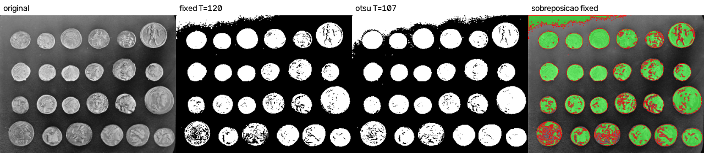

# Relatório técnico M2.1

## 1. Identificação

- Estudante: Kauan Rocha Dalfovo
- Laboratório: M2.1, máscara binária e segmentação
- Disciplina: Processamento de Imagens, 2026-02
- Linguagem: Python 3.13.14, com numpy 2.5.2 e opencv-python 5.0.0.93

## 2. Objetivo

Gerar uma máscara binária de moedas, comparar um limiar fixo em cinza com
outras configurações nas mesmas imagens e escolher a máscara que segue para o
M2.2, apontando os acertos e os erros de cada configuração.

## 3. Operações implementadas

| Método | Função | Saídas geradas |
|---|---|---|
| `fixed` | `threshold_fixed` | `coins_mask_fixed.png`, `moedas_real_separadas_mask_fixed.png` |
| `otsu` | `threshold_otsu` | `coins_mask_otsu.png`, `moedas_real_separadas_mask_otsu.png` |
| `hsv` | `hsv_range` | `moedas_real_separadas_mask_hsv.png` |
| `adaptive` | `threshold_adaptive` | disponível, não usado no estudo |
| sobreposição | `overlay` | `*_overlay_<config>.png` |
| validação | `validate_mask` | conferida em toda máscara gravada |

Todas estão em `src/pdi_lab/segmentation.py`. A limiarização e a conversão de
cor usam as funções do OpenCV, como o enunciado permite.

## 4. Decisões de implementação

### 4.1 Alvo e imagens

O alvo é a moeda. Cada moeda inteira é um objeto, e todo o resto é fundo. Na
máscara, 255 é moeda e 0 é fundo.

| Imagem | Papel | Motivo |
|---|---|---|
| `coins.png` | dificuldade real | o fundo tem tons de cinza parecidos com os das moedas e fica mais claro no topo |
| `moedas_real_separadas.jpg` | condição favorável | moedas separadas sobre fundo claro e sem cor; o fundo escurece nos cantos da esquerda |

As duas têm mais de um objeto: 24 moedas em `coins.png` e 12 em
`moedas_real_separadas.jpg`. Os originais não foram alterados. A origem e a
licença de cada uma estão no `README.md`.

### 4.2 Regra do limiar fixo

O objeto é o pixel com cinza maior que o limiar. O pixel igual ao limiar vai
para o fundo, que é o comportamento do `THRESH_BINARY` do OpenCV. O teste
`test_limiar_fixo_no_limiar_e_dos_dois_lados` fixa essa regra com os valores
119, 120 e 121.

Imagens coloridas são convertidas para cinza antes do limiar.

### 4.3 Inversão

Em `moedas_real_separadas.jpg` as moedas são mais escuras que o fundo. Sem
inversão, os métodos em cinza marcariam o fundo como objeto. Por isso o limiar
fixo e o Otsu dessa imagem usam `--invert`. Em `coins.png` as moedas são mais
claras que o fundo e não há inversão. O HSV não precisa de inversão, porque
seleciona direto os pixels com cor.

### 4.4 Pré-processamento

O limiar fixo e o Otsu não usam pré-processamento, então a diferença entre as
duas máscaras vem só do método e do limiar.

O HSV usa suavização gaussiana 5 x 5 (`--blur 5`). A compressão JPEG deixa
pontos de cor soltos no fundo, e a suavização reduz esses pontos antes da
seleção pela saturação.

### 4.5 Configuração HSV

O fundo da foto é quase sem cor, com saturação mediana 11, e as moedas
douradas e de cobre têm saturação acima de 100. O intervalo escolhido seleciona
saturação de 30 a 255, com qualquer matiz e qualquer valor:
`--hsv-lower 0,30,0 --hsv-upper 179,255,255`. Como o matiz cobre a faixa toda,
não há faixa cruzando o 179 e o 0.

A vantagem é que o escurecimento dos cantos muda o brilho do fundo, mas quase
não muda a saturação.

### 4.6 Validação da máscara

A máscara é conferida duas vezes: na matriz gerada e no arquivo relido do
disco. A conferência verifica as dimensões da entrada, um canal, tipo `uint8`
e valores só em {0, 255}. A saída em JPEG é recusada, porque a compressão cria
valores intermediários. A sobreposição, que é só visualização, é gravada pelo
`lab_1_m2.py` em PNG reduzido para 1280 pixels no lado maior; a máscara fica
no tamanho original.

### 4.7 Guardas

| Situação | Comportamento |
|---|---|
| arquivo inexistente ou que não é imagem | erro explicativo, código de saída 1 |
| método ou operação desconhecidos | código de saída 2, tratado pelo `argparse` |
| `fixed` sem `--threshold` ou limiar fora de 0 a 255 | erro explicativo |
| `--blur` ou `--block-size` par | erro explicativo |
| `adaptive` sem `--c` | erro explicativo |
| `hsv` sem limites, com H acima de 179 ou em imagem cinza | erro explicativo |
| saída `.jpg`, `.jpeg` ou `.webp` para a máscara | erro explicativo, nenhum arquivo gravado |
| máscara com valor fora de {0, 255} ou tamanho diferente | erro explicativo |
| `--output` que é diretório ou não tem extensão | erro explicativo, a máscara só é gravada no caminho exato |
| falha de gravação, como pasta pai inválida | erro explicativo, sem traceback |

## 5. Testes realizados

`python -m pytest` executa 72 testes, todos aprovados.

Cobertura por tipo:

- imagem sintética com pixels abaixo do limiar, no limiar e acima dele, para
  o limiar fixo e para a inversão;
- Otsu em imagem com dois tons, adaptativo com C positivo e negativo e HSV
  com faixa que passa pelo 179 e volta ao 0;
- validação de dimensões, canal único, tipo e valores {0, 255};
- todas as guardas listadas na seção anterior, inclusive a falha de
  gravação;
- códigos de saída 0, 1 e 2 pela linha de comando;
- as duas imagens reais em todas as configurações do estudo, com uma
  limitação conferida em cada uma: o fundo do topo marcado como moeda em
  `coins.png` e o canto escuro marcado como moeda pelo limiar fixo em
  `moedas_real_separadas.jpg`, que o HSV não marca.

## 6. Resultados

Parâmetros das configurações:

| Imagem | Limiar fixo | Otsu | HSV |
|---|---|---|---|
| `coins.png` | `--threshold 120` | limiar calculado 107 | não se aplica, imagem em cinza |
| `moedas_real_separadas.jpg` | `--threshold 85 --invert` | limiar calculado 109, com `--invert` | `--hsv-lower 0,30,0 --hsv-upper 179,255,255 --blur 5` |

Proporção de primeiro plano, de `results/foreground.csv`:

| Imagem | Configuração | Limiar | Pixels de moeda | Proporção |
|---|---|---:|---:|---:|
| `coins.png` | fixed | 120 | 38336 | 32,9% |
| `coins.png` | otsu | 107 | 45117 | 38,8% |
| `moedas_real_separadas.jpg` | fixed + invert | 85 | 1804491 | 17,9% |
| `moedas_real_separadas.jpg` | otsu + invert | 109 | 3150354 | 31,3% |
| `moedas_real_separadas.jpg` | hsv, blur 5 | S >= 30 | 1556885 | 15,5% |

Todas as máscaras passaram na validação da seção 4.6.

Figura 1, `images/output/coins_comparacao.png`: original, limiar fixo, Otsu e
sobreposição do limiar fixo.

Figura 2, `images/output/moedas_real_separadas_comparacao.png`: original,
limiar fixo, Otsu, HSV e sobreposição do HSV.

Na sobreposição, verde é o que foi marcado como moeda e vermelho é o contorno
da máscara. Contorno vermelho dentro de uma moeda indica um furo.

Configuração escolhida para o M2.2:

- `coins.png`: limiar fixo 120. As duas configurações marcam a faixa clara do
  topo como moeda, mas o Otsu piora esse erro. Nas 25 primeiras linhas, que
  são só fundo, o Otsu marca 61,7% dos pixels e o limiar fixo marca 34,6%. Com
  o Otsu a faixa também chega perto da primeira moeda de cima, e as duas podem
  virar uma região só. Em troca, o limiar fixo deixa mais furos nas moedas
  escuras.
- `moedas_real_separadas.jpg`: HSV. No quadrado de 300 x 300 pixels do canto
  inferior esquerdo, que é só fundo, o limiar fixo marca 78,3% como moeda, o
  Otsu marca 100% e o HSV marca 4,2%. No canto superior esquerdo são 100%,
  100% e 13,3%. O HSV separa as 12 moedas, cada uma numa região própria com
  mais de 50000 pixels.

Erros visíveis na configuração escolhida:

| Imagem | Falsos positivos | Falsos negativos |
|---|---|---|
| `coins.png` | faixa clara do fundo no topo, encostada na borda | furos nas moedas de relevo escuro, principalmente na linha de baixo |
| `moedas_real_separadas.jpg` | pontos soltos nos cantos escuros e uma mancha de sujeira no papel, embaixo à esquerda | partes prateadas, que quase não têm cor: as duas moedas de 50 centavos e o centro das moedas de 1 real ficam com furos |

A proporção de primeiro plano é só uma contagem sobre a máscara. Sem máscara
de referência ela não mede acerto, por isso este relatório não declara
acurácia, precisão nem revocação. Os acertos e erros acima são observações
visuais, e as medidas dos cantos usam regiões que, olhando a imagem, são só
fundo.

## 7. Análise técnica

### 7.1 Em que casos o limiar fixo falhou ou funcionou

Funcionou de forma parcial nas duas imagens, por motivos diferentes.

Em `coins.png` o brilho do fundo muda ao longo da imagem. Um limiar baixo o
bastante para preencher as moedas escuras também marca o fundo claro do topo,
e um limiar alto o bastante para limpar o topo esvazia as moedas escuras. O
Otsu também é um limiar global e não resolve.

Em `moedas_real_separadas.jpg` as moedas e o fundo do centro se separam bem
em cinza: a média do fundo no centro é 156 e as moedas douradas e de cobre
ficam abaixo de 60. O problema são os cantos da esquerda, que escurecem até
média 79 no canto inferior. Qualquer limiar que pegue as moedas inteiras
também pega esses cantos. O Otsu, com limiar 109, marca os dois cantos
inteiros, e no canto superior a região do fundo encosta na primeira moeda.

Nesta imagem o HSV funcionou melhor que os dois, porque usa a cor, e não o
brilho, para separar moeda de fundo.

### 7.2 Qual parâmetro foi mais sensível

O limiar fixo nas duas imagens. Em `results/threshold_sensitivity.csv`, em
`coins.png` a proporção cai de 47,4% com limiar 90 para 20,4% com limiar 150,
cerca de 2,3 pontos percentuais a cada 5 níveis de cinza. Em
`moedas_real_separadas.jpg` ela sobe de 8,8% com limiar 60 para 38,5% com
limiar 120, cerca de 2,5 pontos a cada 5 níveis, e quase todo esse aumento vem
do canto escuro crescendo, e não das moedas.

A inversão também decide o resultado, mas é uma escolha e não um ajuste: sem
ela, os métodos em cinza marcariam o fundo de `moedas_real_separadas.jpg`.

### 7.3 Quais erros podem atrapalhar a contagem no M2.2

- A faixa do topo de `coins.png` é grande e vai ser contada como objeto. Um
  filtro por área mínima não a remove, porque ela é maior que as moedas.
- Os furos sozinhos não mudam a contagem, mas uma moeda com muitos furos pode
  se partir em pedaços e ser contada mais de uma vez. Isso pode acontecer nas
  moedas de relevo escuro de `coins.png` e nas moedas prateadas de
  `moedas_real_separadas.jpg`. O fechamento deve ajudar nesse caso.
- Os pontos soltos geram componentes pequenos que aumentam a contagem bruta.
  A abertura ou um filtro por área mínima devem tratar isso.
- Nenhuma das duas imagens tem moedas encostadas, então o caso de duas moedas
  virarem um componente só não aparece neste par.

## 8. Limitações

- Não há máscara de referência. As observações sobre acertos e erros são
  visuais.
- Os limiares fixos, 120 e 85, e o limite de saturação, 30, foram escolhidos
  olhando as sobreposições, com apoio da varredura em
  `results/threshold_sensitivity.csv`, e não por um critério automático.
- O HSV não se aplica a `coins.png`, que é em cinza, então nessa imagem a
  comparação ficou entre limiar fixo e Otsu.
- O método `adaptive` está implementado e testado, mas não faz parte da
  comparação. Em `coins.png` ele deixou as moedas ocas.

## 9. Declaração de uso de IA

Houve uso de IA generativa. Os detalhes estão em [AI_USAGE.md](AI_USAGE.md).

## 10. Referências

- Enunciado do laboratório: [laboratorio_1_M2.md](laboratorio_1_M2.md)
- Contrato técnico dos laboratórios da M1: `lab_tecnico.md`, em
  `lab_tecnico_M1/`
- Rubrica geral: `rubrica_avaliativa.md`, em `lab_tecnico_M1/`
- Contrato técnico complementar da M2: `lab_tecnico_M2/contrato_tecnico.md`
- Rubrica da M2: `lab_tecnico_M2/rubrica_avaliativa.md`
- Documentação do OpenCV sobre limiarização, funções `threshold` e
  `adaptiveThreshold`, e sobre conversão de cor, `cvtColor` e `inRange`
- Documentação do scikit-image sobre o conjunto de dados `skimage.data`, de
  onde vem `coins.png`
- Foto "Moedas do Real até 2010.jpg", de MisterSanderson, Wikimedia Commons,
  CC BY-SA 2.5:
  https://commons.wikimedia.org/wiki/File:Moedas_do_Real_at%C3%A9_2010.jpg
