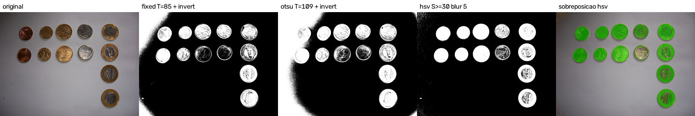
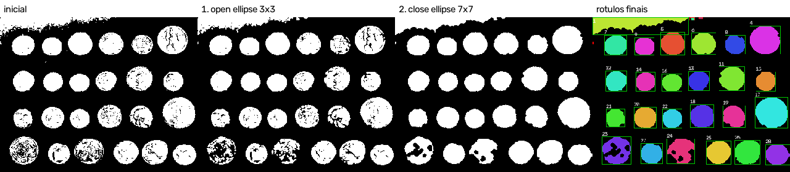
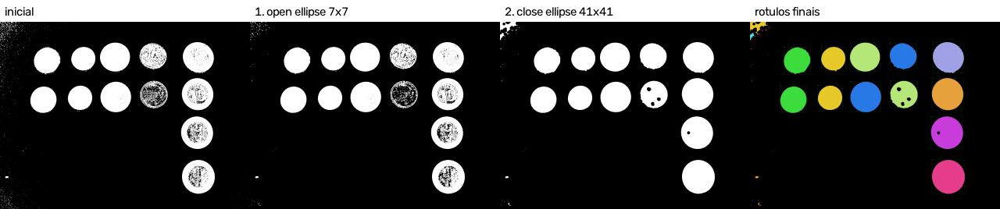
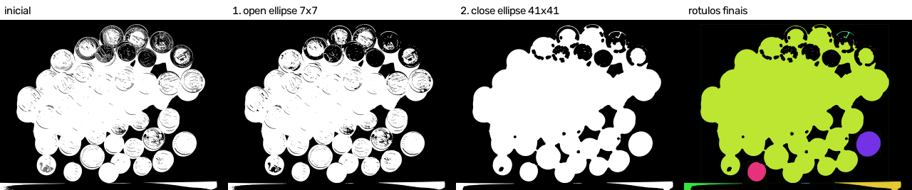

# Relatório técnico M2.1 e M2.2

As seções 1 a 8 são o relatório do M2.1, mantido da entrega anterior. A seção
9 é o M2.2.

## 1. Identificação

- Estudante: Kauan Rocha Dalfovo
- Laboratórios: M2.1, máscara binária e segmentação; M2.2, componentes
  conexos e sequência morfológica
- Disciplina: Processamento de Imagens, 2026-02
- Linguagem: Python 3.13.14, com numpy 2.5.2 e opencv-python 5.0.0.93

## 2. Objetivo

Gerar uma máscara binária de moedas, comparar um limiar fixo em cinza com
outras configurações nas mesmas imagens e escolher a máscara que segue para o
M2.2, apontando os acertos e os erros de cada configuração.

## 3. Operações implementadas

| Método | Função | Saídas geradas |
|---|---|---|
| `fixed` | `threshold_fixed` | `coins_mask_fixed.png`, `moedas_real_separadas_mask_fixed.png` |
| `otsu` | `threshold_otsu` | `coins_mask_otsu.png`, `moedas_real_separadas_mask_otsu.png` |
| `hsv` | `hsv_range` | `moedas_real_separadas_mask_hsv.png` |
| `adaptive` | `threshold_adaptive` | disponível, não usado no estudo |
| sobreposição | `overlay` | `*_overlay_<config>.png` |
| validação | `validate_mask` | conferida em toda máscara gravada |

Todas estão em `src/pdi_lab/segmentation.py`. A limiarização e a conversão de
cor usam as funções do OpenCV, como o enunciado permite.

## 4. Decisões de implementação

### 4.1 Alvo e imagens

O alvo é a moeda. Cada moeda inteira é um objeto, e todo o resto é fundo. Na
máscara, 255 é moeda e 0 é fundo.

| Imagem | Papel | Motivo |
|---|---|---|
| `coins.png` | dificuldade real | o fundo tem tons de cinza parecidos com os das moedas e fica mais claro no topo |
| `moedas_real_separadas.jpg` | condição favorável | moedas separadas sobre fundo claro e sem cor; o fundo escurece nos cantos da esquerda |

As duas têm mais de um objeto: 24 moedas em `coins.png` e 12 em
`moedas_real_separadas.jpg`. Os originais não foram alterados. A origem e a
licença de cada uma estão no `README.md`.

### 4.2 Regra do limiar fixo

O objeto é o pixel com cinza maior que o limiar. O pixel igual ao limiar vai
para o fundo, que é o comportamento do `THRESH_BINARY` do OpenCV. O teste
`test_limiar_fixo_no_limiar_e_dos_dois_lados` fixa essa regra com os valores
119, 120 e 121.

Imagens coloridas são convertidas para cinza antes do limiar.

### 4.3 Inversão

Em `moedas_real_separadas.jpg` as moedas são mais escuras que o fundo. Sem
inversão, os métodos em cinza marcariam o fundo como objeto. Por isso o limiar
fixo e o Otsu dessa imagem usam `--invert`. Em `coins.png` as moedas são mais
claras que o fundo e não há inversão. O HSV não precisa de inversão, porque
seleciona direto os pixels com cor.

### 4.4 Pré-processamento

O limiar fixo e o Otsu não usam pré-processamento, então a diferença entre as
duas máscaras vem só do método e do limiar.

O HSV usa suavização gaussiana 5 x 5 (`--blur 5`). A compressão JPEG deixa
pontos de cor soltos no fundo, e a suavização reduz esses pontos antes da
seleção pela saturação.

### 4.5 Configuração HSV

O fundo da foto é quase sem cor, com saturação mediana 11, e as moedas
douradas e de cobre têm saturação acima de 100. O intervalo escolhido seleciona
saturação de 30 a 255, com qualquer matiz e qualquer valor:
`--hsv-lower 0,30,0 --hsv-upper 179,255,255`. Como o matiz cobre a faixa toda,
não há faixa cruzando o 179 e o 0.

A vantagem é que o escurecimento dos cantos muda o brilho do fundo, mas quase
não muda a saturação.

### 4.6 Validação da máscara

A máscara é conferida duas vezes: na matriz gerada e no arquivo relido do
disco. A conferência verifica as dimensões da entrada, um canal, tipo `uint8`
e valores só em {0, 255}. A saída em JPEG é recusada, porque a compressão cria
valores intermediários. A sobreposição, que é só visualização, é gravada pelo
`lab_1_m2.py` em PNG reduzido para 1280 pixels no lado maior; a máscara fica
no tamanho original.

### 4.7 Guardas

| Situação | Comportamento |
|---|---|
| arquivo inexistente ou que não é imagem | erro explicativo, código de saída 1 |
| método ou operação desconhecidos | código de saída 2, tratado pelo `argparse` |
| `fixed` sem `--threshold` ou limiar fora de 0 a 255 | erro explicativo |
| `--blur` ou `--block-size` par | erro explicativo |
| `adaptive` sem `--c` | erro explicativo |
| `hsv` sem limites, com H acima de 179 ou em imagem cinza | erro explicativo |
| saída `.jpg`, `.jpeg` ou `.webp` para a máscara | erro explicativo, nenhum arquivo gravado |
| máscara com valor fora de {0, 255} ou tamanho diferente | erro explicativo |
| `--output` que é diretório ou não tem extensão | erro explicativo, a máscara só é gravada no caminho exato |
| falha de gravação, como pasta pai inválida | erro explicativo, sem traceback |

## 5. Testes realizados

Na versão do M2.1, `python -m pytest` executa 72 testes, todos aprovados.
A suíte completa da entrega consolidada está na seção 9.4.

Cobertura por tipo:

- imagem sintética com pixels abaixo do limiar, no limiar e acima dele, para
  o limiar fixo e para a inversão;
- Otsu em imagem com dois tons, adaptativo com C positivo e negativo e HSV
  com faixa que passa pelo 179 e volta ao 0;
- validação de dimensões, canal único, tipo e valores {0, 255};
- todas as guardas listadas na seção anterior, inclusive a falha de
  gravação;
- códigos de saída 0, 1 e 2 pela linha de comando;
- as duas imagens reais em todas as configurações do estudo, com uma
  limitação conferida em cada uma: o fundo do topo marcado como moeda em
  `coins.png` e o canto escuro marcado como moeda pelo limiar fixo em
  `moedas_real_separadas.jpg`, que o HSV não marca.

## 6. Resultados

Parâmetros das configurações:

| Imagem | Limiar fixo | Otsu | HSV |
|---|---|---|---|
| `coins.png` | `--threshold 120` | limiar calculado 107 | não se aplica, imagem em cinza |
| `moedas_real_separadas.jpg` | `--threshold 85 --invert` | limiar calculado 109, com `--invert` | `--hsv-lower 0,30,0 --hsv-upper 179,255,255 --blur 5` |

Proporção de primeiro plano, de `results/foreground.csv`:

| Imagem | Configuração | Limiar | Pixels de moeda | Proporção |
|---|---|---:|---:|---:|
| `coins.png` | fixed | 120 | 38336 | 32,9% |
| `coins.png` | otsu | 107 | 45117 | 38,8% |
| `moedas_real_separadas.jpg` | fixed + invert | 85 | 1804491 | 17,9% |
| `moedas_real_separadas.jpg` | otsu + invert | 109 | 3150354 | 31,3% |
| `moedas_real_separadas.jpg` | hsv, blur 5 | S >= 30 | 1556885 | 15,5% |

Todas as máscaras passaram na validação da seção 4.6.

Figura 1, `images/output/coins_comparacao.png`: original, limiar fixo, Otsu e
sobreposição do limiar fixo.

Figura 2, `images/output/moedas_real_separadas_comparacao.png`: original,
limiar fixo, Otsu, HSV e sobreposição do HSV.

Na sobreposição, verde é o que foi marcado como moeda e vermelho é o contorno
da máscara. Contorno vermelho dentro de uma moeda indica um furo.

Configuração escolhida para o M2.2:

- `coins.png`: limiar fixo 120. As duas configurações marcam a faixa clara do
  topo como moeda, mas o Otsu piora esse erro. Nas 25 primeiras linhas, que
  são só fundo, o Otsu marca 61,7% dos pixels e o limiar fixo marca 34,6%. Com
  o Otsu a faixa também chega perto da primeira moeda de cima, e as duas podem
  virar uma região só. Em troca, o limiar fixo deixa mais furos nas moedas
  escuras.
- `moedas_real_separadas.jpg`: HSV. No quadrado de 300 x 300 pixels do canto
  inferior esquerdo, que é só fundo, o limiar fixo marca 78,3% como moeda, o
  Otsu marca 100% e o HSV marca 4,2%. No canto superior esquerdo são 100%,
  100% e 13,3%. O HSV separa as 12 moedas, cada uma numa região própria com
  mais de 50000 pixels.

Erros visíveis na configuração escolhida:

| Imagem | Falsos positivos | Falsos negativos |
|---|---|---|
| `coins.png` | faixa clara do fundo no topo, encostada na borda | furos nas moedas de relevo escuro, principalmente na linha de baixo |
| `moedas_real_separadas.jpg` | pontos soltos nos cantos escuros e uma mancha de sujeira no papel, embaixo à esquerda | partes prateadas, que quase não têm cor: as duas moedas de 50 centavos e o centro das moedas de 1 real ficam com furos |

A proporção de primeiro plano é só uma contagem sobre a máscara. Sem máscara
de referência ela não mede acerto, por isso este relatório não declara
acurácia, precisão nem revocação. Os acertos e erros acima são observações
visuais, e as medidas dos cantos usam regiões que, olhando a imagem, são só
fundo.

## 7. Análise técnica

### 7.1 Em que casos o limiar fixo falhou ou funcionou

Funcionou de forma parcial nas duas imagens, por motivos diferentes.

Em `coins.png` o brilho do fundo muda ao longo da imagem. Um limiar baixo o
bastante para preencher as moedas escuras também marca o fundo claro do topo,
e um limiar alto o bastante para limpar o topo esvazia as moedas escuras. O
Otsu também é um limiar global e não resolve.

Em `moedas_real_separadas.jpg` as moedas e o fundo do centro se separam bem
em cinza: a média do fundo no centro é 156 e as moedas douradas e de cobre
ficam abaixo de 60. O problema são os cantos da esquerda, que escurecem até
média 79 no canto inferior. Qualquer limiar que pegue as moedas inteiras
também pega esses cantos. O Otsu, com limiar 109, marca os dois cantos
inteiros, e no canto superior a região do fundo encosta na primeira moeda.

Nesta imagem o HSV funcionou melhor que os dois, porque usa a cor, e não o
brilho, para separar moeda de fundo.

### 7.2 Qual parâmetro foi mais sensível

O limiar fixo nas duas imagens. Em `results/threshold_sensitivity.csv`, em
`coins.png` a proporção cai de 47,4% com limiar 90 para 20,4% com limiar 150,
cerca de 2,3 pontos percentuais a cada 5 níveis de cinza. Em
`moedas_real_separadas.jpg` ela sobe de 8,8% com limiar 60 para 38,5% com
limiar 120, cerca de 2,5 pontos a cada 5 níveis, e quase todo esse aumento vem
do canto escuro crescendo, e não das moedas.

A inversão também decide o resultado, mas é uma escolha e não um ajuste: sem
ela, os métodos em cinza marcariam o fundo de `moedas_real_separadas.jpg`.

### 7.3 Quais erros podem atrapalhar a contagem no M2.2

- A faixa do topo de `coins.png` é grande e vai ser contada como objeto. Um
  filtro por área mínima não a remove, porque ela é maior que as moedas.
- Os furos sozinhos não mudam a contagem, mas uma moeda com muitos furos pode
  se partir em pedaços e ser contada mais de uma vez. Isso pode acontecer nas
  moedas de relevo escuro de `coins.png` e nas moedas prateadas de
  `moedas_real_separadas.jpg`. O fechamento deve ajudar nesse caso.
- Os pontos soltos geram componentes pequenos que aumentam a contagem bruta.
  A abertura ou um filtro por área mínima devem tratar isso.
- Nenhuma das duas imagens tem moedas encostadas, então o caso de duas moedas
  virarem um componente só não aparece neste par.

## 8. Limitações

- Não há máscara de referência. As observações sobre acertos e erros são
  visuais.
- Os limiares fixos, 120 e 85, e o limite de saturação, 30, foram escolhidos
  olhando as sobreposições, com apoio da varredura em
  `results/threshold_sensitivity.csv`, e não por um critério automático.
- O HSV não se aplica a `coins.png`, que é em cinza, então nessa imagem a
  comparação ficou entre limiar fixo e Otsu.
- O método `adaptive` está implementado e testado, mas não faz parte da
  comparação. Em `coins.png` ele deixou as moedas ocas.

## 9. M2.2: componentes conexos e sequência morfológica

### 9.1 Objetivo

Partir das máscaras do M2.1, rotular os componentes conexos com conectividade
4 e 8, limpar a máscara com uma sequência morfológica justificada e contar os
objetos de novo, comparando o antes e o depois.

### 9.2 Operações implementadas

| Etapa | Função | Saídas geradas, com o prefixo de `--output` |
|---|---|---|
| leitura da sequência | `load_sequence`, `parse_steps` | lida de `config/<nome>.json` |
| cópia da máscara inicial | `save_image` | `_initial_mask.png` |
| rotulação | `label_components` | `_initial.csv`, `_final.csv` |
| sequência morfológica | `apply_step` | `_stage_1_open.png`, `_stage_2_close.png`, `_final_mask.png` |
| filtro por área | `apply_min_area` | coluna `kept` dos CSV |
| imagem de rótulos | `labels_image` | `_labels.png` |
| resumo | `count_summary` | `_summary.json` |

As funções estão em `src/pdi_lab/analysis.py` e a operação `analyze` está em
`src/pdi_lab/cli.py`. A rotulação usa `connectedComponentsWithStats` e a
morfologia usa `morphologyEx`, do OpenCV.

### 9.3 Decisões de implementação

#### 9.3.1 Imagens e máscaras de partida

| Imagem | Máscara de partida | Comportamento |
|---|---|---|
| `coins.png` | escolhida no M2.1, limiar fixo 120 | ruído pequeno, moedas com furos e a faixa clara do topo |
| `moedas_real_separadas.jpg` | escolhida no M2.1, HSV com saturação >= 30 | moedas separadas, pontos soltos nos cantos e moedas prateadas com muitos furos |
| `moedas_real_empilhadas.jpg` | gerada no M2.2, Otsu invertido com suavização 5 x 5 | moedas encostadas e sobrepostas, caso de contato |

A terceira imagem entrou no M2.2 porque nenhuma das duas do M2.1 tem moedas
encostadas. A máscara dela usa Otsu com inversão, porque as moedas são mais
escuras que o papel, e suavização 5 x 5 para reduzir o ruído da compressão
JPEG. O comando está no `README.md`.

Nas três máscaras, a moeda está em branco, 255, e o fundo em preto, 0. A
operação `analyze` recusa entrada colorida ou com valores fora de {0, 255}, e
grava uma cópia da máscara inicial antes de qualquer operação.

#### 9.3.2 Sequência morfológica

Foram usadas duas sequências com a mesma ordem, mudando só o tamanho do
elemento estruturante, porque as fotos têm cerca de 90 vezes mais pixels que
`coins.png`:

| Arquivo | Ordem | Operação | Elemento estruturante | Iterações | Problema visado |
|---|---:|---|---|---:|---|
| `config/coins.json` | 1 | abertura | elipse 3 x 3 | 1 | pontos isolados de fundo |
| `config/coins.json` | 2 | fechamento | elipse 7 x 7 | 1 | furos pequenos dentro das moedas e pedaços separados da mesma moeda |
| `config/moedas_real.json` | 1 | abertura | elipse 7 x 7 | 1 | pontos de cor e de sombra soltos no fundo |
| `config/moedas_real.json` | 2 | fechamento | elipse 41 x 41 | 1 | furos das partes prateadas e dos reflexos |

A abertura vem primeiro para tirar os pontos soltos antes do fechamento. Na
ordem inversa, o fechamento juntaria esses pontos às moedas vizinhas, e eles
deixariam de ser removíveis pela abertura.

A elipse foi escolhida porque as moedas são redondas. O tamanho da abertura
foi escolhido para remover a maior parte dos pontos de ruído de cada imagem
sem apagar as moedas, e o do fechamento para fechar os furos sem juntar as
moedas separadas de `moedas_real_separadas.jpg`. Na máscara do M2.1, a menor
distância entre duas moedas é de 68 pixels, maior que o elemento de 41.

#### 9.3.3 Conectividade da análise final

A análise final usa conectividade 8. Os pedaços de uma moeda com relevo escuro
ou com partes prateadas muitas vezes se tocam só pelo canto, e com
conectividade 4 cada pedaço vira um componente. Os CSV e a imagem de rótulos
usam a conectividade escolhida, e as contagens nas duas conectividades ficam
no resumo.

#### 9.3.4 Filtro por área

Critério: um componente é mantido quando tem pelo menos cerca de metade da
área da menor moeda da imagem. A menor moeda depois da sequência tem 1055
pixels em `coins.png` e 96404 pixels em `moedas_real_separadas.jpg`, então a
área mínima ficou em 500 pixels para `coins.png` e 50000 pixels para as duas
fotos, que têm a mesma resolução e moedas de tamanho parecido em pixels.

O mesmo critério foi aplicado à máscara inicial e à final de cada imagem, e os
CSV marcam em `kept` se o componente passou. As contagens brutas, antes do
filtro, também são registradas.

#### 9.3.5 Guardas

| Situação | Comportamento |
|---|---|
| `--connectivity` diferente de 4 ou 8 | código de saída 2, tratado pelo `argparse` |
| `--min-area` negativo | erro explicativo, código de saída 1 |
| `analyze` sem `--sequence`, arquivo inexistente ou JSON inválido | erro explicativo |
| sequência com menos de duas operações ou sem abertura nem fechamento | erro explicativo |
| dois passos seguidos idênticos | erro explicativo |
| operação, forma, tamanho par ou iterações inválidos | erro explicativo |
| passo sem `purpose` | erro explicativo |
| entrada colorida ou com valores fora de {0, 255} | erro explicativo |
| máscara vazia | contagem zero e CSV só com o cabeçalho |
| máscara inexistente ou ilegível | erro explicativo |
| falha de gravação, como prefixo dentro de um arquivo | erro explicativo, sem traceback |

### 9.4 Testes realizados

`python -m pytest` executa 115 testes na entrega consolidada, todos
aprovados. Os testes do M2.2 cobrem:

- máscara sintética com dois pixels só na diagonal: 2 componentes em
  conectividade 4 e 1 em conectividade 8;
- máscara sintética com ruído isolado e uma região principal: a abertura
  remove o ruído e mantém a região;
- furo pequeno numa região: o fechamento preenche o furo;
- duas regiões próximas: um fechamento grande junta as duas;
- máscara vazia, com contagem zero, e objeto que toca a borda da imagem;
- `--connectivity` inválido, máscara inexistente, falha de gravação e as
  demais guardas da seção anterior;
- reexecução das três imagens reais com saídas intermediárias e CSV,
  conferindo que a soma das áreas dos componentes brutos é igual ao número de
  pixels de primeiro plano da máscara, na inicial e na final;
- contagens esperadas nas imagens reais: 25 em `coins.png`, 12 em
  `moedas_real_separadas.jpg` e, em `moedas_real_empilhadas.jpg`, um
  componente com mais de 80% da área final.

### 9.5 Resultados

Tabela antes e depois, de `results/comparison.csv`, com conectividade 8:

| Análise | Área mínima | Iniciais, brutos | Iniciais, após filtro | Finais, brutos | Finais, após filtro | Área inicial | Área final |
|---|---:|---:|---:|---:|---:|---:|---:|
| `coins` | 500 | 87 | 25 | 28 | 25 | 38336 | 40069 |
| `moedas_real_separadas` | 50000 | 1812 | 12 | 32 | 12 | 1556885 | 1683610 |
| `moedas_real_empilhadas` | 50000 | 856 | 6 | 27 | 4 | 4486326 | 4746073 |

Contagem em cada estágio, de `results/<prefixo>_summary.json`:

| Análise | Estágio | Brutos | Após filtro | Área |
|---|---|---:|---:|---:|
| `coins` | inicial | 87 | 25 | 38336 |
| `coins` | 1, abertura 3 x 3 | 50 | 25 | 36843 |
| `coins` | 2, fechamento 7 x 7 | 28 | 25 | 40069 |
| `moedas_real_separadas` | inicial | 1812 | 12 | 1556885 |
| `moedas_real_separadas` | 1, abertura 7 x 7 | 265 | 11 | 1497625 |
| `moedas_real_separadas` | 2, fechamento 41 x 41 | 32 | 12 | 1683610 |
| `moedas_real_empilhadas` | inicial | 856 | 6 | 4486326 |
| `moedas_real_empilhadas` | 1, abertura 7 x 7 | 325 | 6 | 4361924 |
| `moedas_real_empilhadas` | 2, fechamento 41 x 41 | 27 | 4 | 4746073 |

Conectividade 4 e 8 na mesma máscara:

| Máscara | Conectividade 4 | Conectividade 8 |
|---|---:|---:|
| `coins`, inicial | 190 | 87 |
| `coins`, final | 28 | 28 |
| `moedas_real_separadas`, inicial | 2324 | 1812 |
| `moedas_real_separadas`, final | 34 | 32 |
| `moedas_real_empilhadas`, inicial | 1005 | 856 |
| `moedas_real_empilhadas`, final | 31 | 27 |

Figura 3, `images/output/coins_estagios.png`: máscara inicial, abertura,
fechamento e rótulos finais.

Figura 4, `images/output/moedas_real_separadas_estagios.png`.

Figura 5, `images/output/moedas_real_empilhadas_estagios.png`.

Na imagem de rótulos, cada componente tem uma cor, a caixa verde indica
componente mantido pelo filtro e a caixa vermelha indica componente filtrado.

Observações sobre as mudanças:

- Em `coins`, a abertura reduziu os componentes brutos de 87 para 50 e a área
  em 3,9%. Ela também partiu duas moedas de relevo escuro da linha de baixo em
  cinco pedaços; com o filtro de 500 pixels só o maior pedaço de cada uma
  passa, então a contagem filtrada ficou em 25, mas essas moedas perderam
  área. O fechamento juntou os pedaços de novo, e a área final ficou 4,5%
  acima da inicial.
- Em `moedas_real_separadas`, a abertura tirou a maior parte dos pontos
  soltos, de 1812 para 265 componentes, mas a contagem filtrada caiu de 12
  para 11. A moeda prateada de 50 centavos da segunda linha, que já tinha
  muitos furos, se partiu em 131 pedaços, e o maior ficou com 24341 pixels,
  abaixo do filtro. O fechamento 41 x 41 juntou a moeda de novo, com 118064
  pixels, e a contagem voltou a 12.
- Em `moedas_real_empilhadas`, a contagem filtrada caiu de 6 para 4 com o
  fechamento, como mostra a seção 9.6.4.
- Em todas, os contornos ficaram mais arredondados depois do fechamento. Em
  `coins` os furos grandes das moedas da linha de baixo continuam, porque são
  maiores que o elemento 7 x 7.

### 9.6 Análise técnica

#### 9.6.1 Diferença entre conectividade 4 e 8

Na conectividade 4, dois pixels só fazem parte do mesmo componente se
encostam pela lateral. Na conectividade 8, encostar pelo canto também conta.

Na máscara inicial a diferença é grande nas três imagens: 190 contra 87 em
`coins`, 2324 contra 1812 em `moedas_real_separadas` e 1005 contra 856 em
`moedas_real_empilhadas`. O ruído e a textura das moedas deixam muitos pixels
ligados só pela diagonal, e na conectividade 4 cada ligação diagonal separa
um componente.

Depois da sequência a diferença quase some: 28 contra 28, 34 contra 32 e 31
contra 27. O fechamento com elipse deixa os contornos grossos, sem ligações só
pelo canto. A pequena diferença que sobra nas fotos vem dos pontos soltos que
a abertura não removeu, e nenhum deles passa no filtro de área.

#### 9.6.2 Justificativa das escolhas

A abertura trata o defeito mais numeroso das máscaras iniciais: em `coins`,
62 dos 87 componentes têm menos de 100 pixels, e em `moedas_real_separadas`
1800 dos 1812 componentes têm menos de 50000 pixels, 390 deles com 1 pixel
só. O fechamento trata o segundo defeito, os furos e os pedaços separados
dentro das moedas, que vieram do relevo escuro em `coins.png` e das partes
prateadas, quase sem cor, na foto segmentada por HSV. Cada passo tem uma
finalidade diferente, e o arquivo de configuração registra essa finalidade no
campo `purpose`.

#### 9.6.3 Caso em que a sequência ajuda

Em `moedas_real_separadas` a sequência resolve o problema: de 1812
componentes brutos para 32, e 12 depois do filtro, que é exatamente o número
de moedas. A moeda prateada que a máscara do M2.1 tinha deixado cheia de
furos voltou a ser um componente só.

Em `coins` ela tira o ruído, de 87 para 28 componentes brutos, e deixa cada
moeda num componente só.

#### 9.6.4 Efeito indesejado e caso em que a sequência não resolve

Contato entre moedas. Em `moedas_real_empilhadas`, as moedas encostadas e
sobrepostas já formam um componente só na máscara inicial: um bloco de
3805865 pixels que cobre quase toda a pilha. A morfologia não separa esse
bloco, porque não há fundo entre as moedas para a abertura alargar.

Fechamento que junta objetos. Na mesma imagem, o fechamento 41 x 41, que nas
moedas separadas só fechou furos, juntou ao bloco duas moedas que estavam
isoladas na máscara inicial, a de 1 real comemorativa e uma de 50 centavos,
porque elas ficavam a poucos pixels da pilha. A contagem filtrada caiu de 6
para 4, e o bloco final tem 4439217 pixels, mais de 90% da área final.

Erros da segmentação que a morfologia não corrige. Em `coins`, a faixa clara
do fundo no topo continua como o maior componente, com 3106 pixels e caixa em
x = 0, y = 0, 187 x 34. Ela é maior que qualquer moeda, cuja maior área é 2996
pixels, então nem a abertura nem o filtro por área a removem. Em
`moedas_real_empilhadas`, a faixa escura abaixo da borda do papel, na parte de
baixo da foto, também passa no filtro, com 72713 pixels.

#### 9.6.5 A contagem se aproxima da interpretação humana?

Em `moedas_real_separadas`, sim: 12 componentes e 12 moedas.

Em `coins`, quase: 25 componentes depois do filtro, para 24 moedas. A
diferença é a faixa do fundo. Excluindo esse componente, cada moeda
corresponde a um componente.

Em `moedas_real_empilhadas`, não: 4 componentes depois do filtro, que são o
bloco da pilha, duas moedas isoladas e a faixa abaixo do papel. Só na metade
de baixo da foto dá para ver mais de 20 moedas, e o número total não pode ser
contado pela imagem, porque as moedas de baixo das pilhas ficam escondidas.

A contagem de componentes não equivale ao número real de objetos. Ela conta
regiões conectadas da máscara, e três situações fazem as duas coisas
diferirem: falso positivo da segmentação, como a faixa do fundo, que soma um
objeto que não existe; fragmentação, quando uma moeda se parte e é contada
mais de uma vez ou some no filtro, como a moeda prateada depois da abertura;
e fusão, por contato ou por fechamento, quando várias moedas viram uma, como
na foto empilhada. A contagem só se aproxima do número real quando a máscara
não tem nenhum desses três defeitos.

### 9.7 Limitações

- A contagem de referência é visual: 24 moedas em `coins.png` e 12 em
  `moedas_real_separadas.jpg`. Para `moedas_real_empilhadas.jpg` não há
  contagem de referência, porque parte das moedas está escondida.
- O tamanho dos elementos estruturantes e a área mínima dependem da
  resolução, então foram definidos separadamente para `coins.png` e para as
  fotos.
- O filtro por área não remove falsos positivos grandes, como a faixa do
  fundo de `coins.png` e a faixa abaixo do papel na foto empilhada.
- A separação de moedas encostadas exigiria outra técnica, como watershed,
  que é extensão opcional e ficou fora deste laboratório.

## 10. Declaração de uso de IA

Houve uso de IA generativa. Os detalhes estão em [AI_USAGE.md](AI_USAGE.md).

## 11. Referências

- Enunciado do M2.1: [laboratorio_1_M2.md](laboratorio_1_M2.md)
- Enunciado do M2.2: [laboratorio_2_M2.md](laboratorio_2_M2.md)
- Contrato técnico dos laboratórios da M1: `lab_tecnico.md`, em
  `lab_tecnico_M1/`
- Rubrica geral: `rubrica_avaliativa.md`, em `lab_tecnico_M1/`
- Contrato técnico complementar da M2: `lab_tecnico_M2/contrato_tecnico.md`
- Rubrica da M2: `lab_tecnico_M2/rubrica_avaliativa.md`
- Documentação do OpenCV sobre limiarização, conversão de cor, operações
  morfológicas (`morphologyEx`, `getStructuringElement`) e rotulação
  (`connectedComponentsWithStats`)
- Documentação do scikit-image sobre o conjunto de dados `skimage.data`, de
  onde vem `coins.png`
- Fotos "Moedas do Real até 2010.jpg" e "Moedas do Real até 2010 -
  empilhadas.jpg", de MisterSanderson, Wikimedia Commons, CC BY-SA 2.5:
  https://commons.wikimedia.org/wiki/File:Moedas_do_Real_at%C3%A9_2010.jpg e
  https://commons.wikimedia.org/wiki/File:Moedas_do_Real_at%C3%A9_2010_-_empilhadas.jpg
