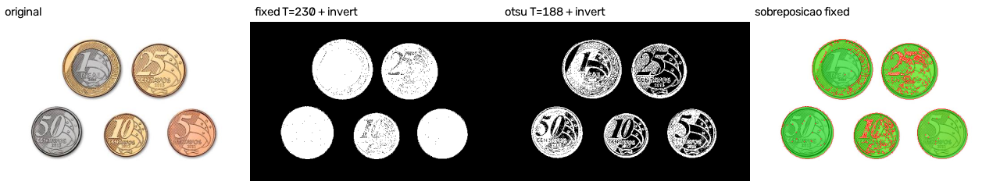
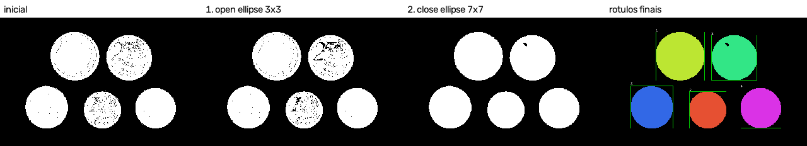
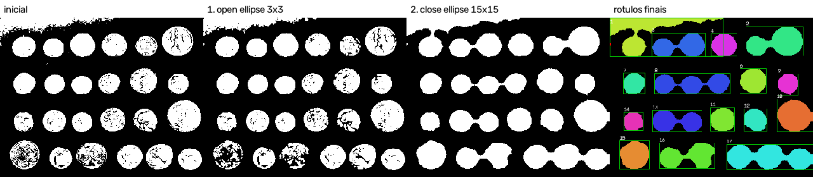

# Relatório técnico M2.1 e M2.2

As seções 1 a 8 são o relatório do M2.1, mantido da entrega anterior. A seção
9 é o M2.2.

## 1. Identificação

- Estudante: Kauan Rocha Dalfovo
- Laboratórios: M2.1, máscara binária e segmentação; M2.2, componentes
  conexos e sequência morfológica
- Disciplina: Processamento de Imagens, 2026-02
- Linguagem: Python 3.13.14, com numpy 2.5.2 e opencv-python 5.0.0.93

## 2. Objetivo

Gerar uma máscara binária de moedas, comparar um limiar fixo em cinza com o
método de Otsu nas mesmas imagens e escolher a máscara que segue para o M2.2,
apontando os acertos e os erros de cada configuração.

## 3. Operações implementadas

| Método | Função | Saídas geradas |
|---|---|---|
| `fixed` | `threshold_fixed` | `coins_mask_fixed.png`, `moedas_brasileiras_mask_fixed.png` |
| `otsu` | `threshold_otsu` | `coins_mask_otsu.png`, `moedas_brasileiras_mask_otsu.png` |
| `adaptive` | `threshold_adaptive` | disponível, não usado no estudo |
| `hsv` | `hsv_range` | disponível, não usado no estudo |
| sobreposição | `overlay` | `*_overlay_fixed.png`, `*_overlay_otsu.png` |
| validação | `validate_mask` | conferida em toda máscara gravada |

Todas estão em `src/pdi_lab/segmentation.py`. A limiarização usa as funções
do OpenCV, como o enunciado permite.

## 4. Decisões de implementação

### 4.1 Alvo e imagens

O alvo é a moeda. Cada moeda inteira é um objeto, e todo o resto é fundo. Na
máscara, 255 é moeda e 0 é fundo.

| Imagem | Papel | Motivo |
|---|---|---|
| `coins.png` | dificuldade real | o fundo tem tons de cinza parecidos com os das moedas e fica mais claro no topo |
| `moedas_brasileiras.jpg` | condição favorável | fundo branco uniforme e cinco moedas separadas |

As duas têm mais de um objeto: 24 moedas em `coins.png` e 5 em
`moedas_brasileiras.jpg`. Os originais não foram alterados.

### 4.2 Regra do limiar fixo

O objeto é o pixel com cinza maior que o limiar. O pixel igual ao limiar vai
para o fundo, que é o comportamento do `THRESH_BINARY` do OpenCV. O teste
`test_limiar_fixo_no_limiar_e_dos_dois_lados` fixa essa regra com os valores
119, 120 e 121.

Imagens coloridas são convertidas para cinza antes do limiar.

### 4.3 Inversão

Em `moedas_brasileiras.jpg` as moedas são mais escuras que o fundo. Sem
inversão, a máscara marcaria o fundo branco como objeto. Por isso as duas
configurações dessa imagem usam `--invert`. Em `coins.png` as moedas são mais
claras que o fundo e não há inversão.

### 4.4 Pré-processamento

Nenhuma das configurações comparadas usa pré-processamento, então a diferença
entre as máscaras vem só do método e do limiar.

Foi testado o Otsu com suavização gaussiana 5 x 5 em `coins.png`. O limiar
calculado foi 104 e a proporção de primeiro plano subiu de 38,8% para 41,3%.
Os pontos isolados diminuíram, mas mais fundo passou a ser marcado como
moeda, então a suavização não foi usada.

### 4.5 Validação da máscara

A máscara é conferida duas vezes: na matriz gerada e no arquivo relido do
disco. A conferência verifica as dimensões da entrada, um canal, tipo `uint8`
e valores só em {0, 255}. A saída em JPEG é recusada, porque a compressão cria
valores intermediários.

### 4.6 Guardas

| Situação | Comportamento |
|---|---|
| arquivo inexistente ou que não é imagem | erro explicativo, código de saída 1 |
| método ou operação desconhecidos | código de saída 2, tratado pelo `argparse` |
| `fixed` sem `--threshold` ou limiar fora de 0 a 255 | erro explicativo |
| `--blur` ou `--block-size` par | erro explicativo |
| `adaptive` sem `--c` | erro explicativo |
| `hsv` sem limites, com H acima de 179 ou em imagem cinza | erro explicativo |
| saída `.jpg`, `.jpeg` ou `.webp` | erro explicativo, nenhum arquivo gravado |
| máscara com valor fora de {0, 255} ou tamanho diferente | erro explicativo |

## 5. Testes realizados

Na entrega do M2.1, `python -m pytest` executava 69 testes, todos aprovados.
A suíte completa da entrega consolidada está na seção 9.4.

Cobertura por tipo:

- imagem sintética com pixels abaixo do limiar, no limiar e acima dele, para
  o limiar fixo e para a inversão;
- Otsu em imagem com dois tons, adaptativo com C positivo e negativo e HSV
  com faixa que passa pelo 179 e volta ao 0;
- validação de dimensões, canal único, tipo e valores {0, 255};
- todas as guardas listadas na seção anterior;
- códigos de saída 0, 1 e 2 pela linha de comando;
- as duas imagens reais nas duas configurações, com uma limitação conferida
  em cada uma: o fundo do topo marcado como moeda em `coins.png` e o Otsu
  perdendo o interior das moedas em `moedas_brasileiras.jpg`.

## 6. Resultados

Parâmetros das duas configurações:

| Imagem | Limiar fixo | Otsu |
|---|---|---|
| `coins.png` | `--threshold 120` | limiar calculado 107 |
| `moedas_brasileiras.jpg` | `--threshold 230 --invert` | limiar calculado 188, com `--invert` |

Proporção de primeiro plano, de `results/foreground.csv`:

| Imagem | Configuração | Limiar | Pixels de moeda | Proporção |
|---|---|---:|---:|---:|
| `coins.png` | fixed | 120 | 38336 | 32,9% |
| `coins.png` | otsu | 107 | 45117 | 38,8% |
| `moedas_brasileiras.jpg` | fixed + invert | 230 | 54543 | 27,3% |
| `moedas_brasileiras.jpg` | otsu + invert | 188 | 32198 | 16,1% |

Todas as máscaras passaram na validação da seção 4.5.

Figura 1, `images/output/coins_comparacao.png`: original, limiar fixo, Otsu e
sobreposição do limiar fixo.

Figura 2, `images/output/moedas_brasileiras_comparacao.png`: original, limiar
fixo, Otsu e sobreposição do limiar fixo.

Na sobreposição, verde é o que foi marcado como moeda e vermelho é o contorno
da máscara. Contorno vermelho dentro de uma moeda indica um furo.

Configuração escolhida para o M2.2: limiar fixo nas duas imagens.

- `coins.png`: as duas configurações marcam a faixa clara do topo como moeda,
  mas o Otsu piora esse erro. Nas 25 primeiras linhas, que são só fundo, o
  Otsu marca 61,7% dos pixels e o limiar fixo marca 34,6%. Com o Otsu a faixa
  também chega perto da primeira moeda de cima, e as duas podem virar uma
  região só. Em troca, o limiar fixo deixa mais furos nas moedas escuras.
- `moedas_brasileiras.jpg`: o limiar fixo pega as cinco moedas quase
  inteiras. O Otsu marca só os relevos e as bordas.

Erros visíveis na configuração escolhida:

| Imagem | Falsos positivos | Falsos negativos |
|---|---|---|
| `coins.png` | faixa clara do fundo no topo, encostada na borda | furos nas moedas de relevo escuro, principalmente na linha de baixo |
| `moedas_brasileiras.jpg` | pontos soltos perto da borda das moedas, por causa da compressão JPEG | furos onde o relevo é muito claro, nas moedas de 25 e 10 centavos |

A proporção de primeiro plano é só uma contagem sobre a máscara. Sem máscara
de referência ela não mede acerto, por isso este relatório não declara
acurácia, precisão nem revocação. Os acertos e erros acima são observações
visuais.

## 7. Análise técnica

### 7.1 Em que casos o limiar fixo falhou ou funcionou

Funcionou em `moedas_brasileiras.jpg`. O fundo é branco e uniforme e
nenhuma moeda chega ao branco, então qualquer limiar entre 220 e 240 dá uma
máscara parecida, com proporção entre 25,1% e 28,7%.

Falhou em parte em `coins.png`, porque o brilho do fundo muda ao longo da
imagem. Um limiar baixo o bastante para preencher as moedas escuras também
marca o fundo claro do topo, e um limiar alto o bastante para limpar o topo
esvazia as moedas escuras. O Otsu também é um limiar global e não resolve.

O Otsu falhou em `moedas_brasileiras.jpg` por outro motivo: mais da metade da
imagem é fundo branco, com mediana do cinza igual a 255, e o limiar
calculado, 188, acabou separando os tons de dentro das moedas.

### 7.2 Qual parâmetro foi mais sensível

O limiar em `coins.png`. Em `results/threshold_sensitivity.csv`, a proporção
cai de 47,4% com limiar 90 para 20,4% com limiar 150, cerca de 2,3 pontos
percentuais a cada 5 níveis de cinza. Em `moedas_brasileiras.jpg`, entre 220
e 250 a variação total é de 5,2 pontos, porque o fundo está em 255 e não muda
de lado.

A inversão também decide o resultado, mas é uma escolha e não um ajuste: sem
ela a máscara de `moedas_brasileiras.jpg` marcaria o fundo.

### 7.3 Quais erros podem atrapalhar a contagem no M2.2

- A faixa do topo de `coins.png` é grande e vai ser contada como objeto. Um
  filtro por área mínima não a remove, porque ela é maior que as moedas.
- Os furos sozinhos não mudam a contagem, mas uma moeda com muitos furos pode
  se partir em pedaços e ser contada mais de uma vez. O fechamento deve
  ajudar nesse caso.
- Os pontos soltos geram componentes pequenos que aumentam a contagem bruta.
  A abertura ou um filtro por área mínima devem tratar isso.
- Nenhuma das imagens tem moedas encostadas, então o caso de duas moedas
  virarem um componente só não aparece neste par.

## 8. Limitações

- A fonte original e a licença de `moedas_brasileiras.jpg` ainda não foram
  verificadas.
- Não há máscara de referência. As observações sobre acertos e erros são
  visuais.
- Os limiares fixos, 120 e 230, foram escolhidos olhando as sobreposições,
  com apoio da varredura em `results/threshold_sensitivity.csv`, e não por um
  critério automático.
- Os métodos `adaptive` e `hsv` estão implementados e testados, mas não fazem
  parte da comparação principal. Em `coins.png` o adaptativo deixou as moedas
  ocas, e em `moedas_brasileiras.jpg` o HSV por saturação perdeu as partes
  prateadas, que quase não têm saturação.

## 9. M2.2: componentes conexos e sequência morfológica

### 9.1 Objetivo

Partir das máscaras do M2.1, rotular os componentes conexos com conectividade
4 e 8, limpar a máscara com uma sequência morfológica justificada e contar os
objetos de novo, comparando o antes e o depois.

### 9.2 Operações implementadas

| Etapa | Função | Saídas geradas, com o prefixo de `--output` |
|---|---|---|
| leitura da sequência | `load_sequence`, `parse_steps` | lida de `config/sequence.json` |
| cópia da máscara inicial | `save_image` | `_initial_mask.png` |
| rotulação | `label_components` | `_initial.csv`, `_final.csv` |
| sequência morfológica | `apply_step` | `_stage_1_open.png`, `_stage_2_close.png`, `_final_mask.png` |
| filtro por área | `apply_min_area` | coluna `kept` dos CSV |
| imagem de rótulos | `labels_image` | `_labels.png` |
| resumo | `count_summary` | `_summary.json` |

As funções estão em `src/pdi_lab/analysis.py` e a operação `analyze` está em
`src/pdi_lab/cli.py`. A rotulação usa `connectedComponentsWithStats` e a
morfologia usa `morphologyEx`, do OpenCV.

### 9.3 Decisões de implementação

#### 9.3.1 Máscara de partida

As máscaras de partida são as escolhidas no M2.1, `coins_mask.png` e
`moedas_brasileiras_mask.png`, refeitas pelo `lab_2_m2.py` com os mesmos
comandos documentados. Nas duas, a moeda está em branco, 255, e o fundo em
preto, 0. A operação `analyze` recusa entrada colorida ou com valores fora de
{0, 255}, e grava uma cópia da máscara inicial antes de qualquer operação.

#### 9.3.2 Sequência morfológica

A sequência está em `config/sequence.json` e foi a mesma nas duas imagens:

| Ordem | Operação | Elemento estruturante | Iterações | Problema visado |
|---:|---|---|---:|---|
| 1 | abertura | elipse 3 x 3 | 1 | pontos isolados de fundo e ruído da compressão JPEG |
| 2 | fechamento | elipse 7 x 7 | 1 | furos pequenos dentro das moedas e pedaços separados da mesma moeda |

A abertura vem primeiro para tirar os pontos soltos antes do fechamento. Na
ordem inversa, o fechamento juntaria esses pontos às moedas vizinhas, e eles
deixariam de ser removíveis pela abertura.

A elipse foi escolhida porque as moedas são redondas. O tamanho 3 é o menor
elemento que remove pontos de 1 ou 2 pixels. O tamanho 7 fecha os furos
pequenos sem juntar moedas vizinhas. A seção 9.6.4 mostra o que acontece com
15.

#### 9.3.3 Conectividade da análise final

A análise final usa conectividade 8. Os pedaços de uma moeda com relevo escuro
muitas vezes se tocam só pelo canto, e com conectividade 4 cada pedaço vira um
componente. Os CSV e a imagem de rótulos usam a conectividade escolhida, e as
contagens nas duas conectividades ficam no resumo.

#### 9.3.4 Filtro por área

Critério: um componente é mantido quando tem área de pelo menos 100 pixels.
A menor moeda depois da sequência tem 1055 pixels em `coins.png`, então o
critério fica bem abaixo de qualquer moeda e acima dos pontos de ruído. O
mesmo critério foi aplicado à máscara inicial e à final, e os CSV marcam em
`kept` se o componente passou. As contagens brutas, antes do filtro, também
são registradas.

#### 9.3.5 Guardas

| Situação | Comportamento |
|---|---|
| `--connectivity` diferente de 4 ou 8 | código de saída 2, tratado pelo `argparse` |
| `--min-area` negativo | erro explicativo, código de saída 1 |
| `analyze` sem `--sequence`, arquivo inexistente ou JSON inválido | erro explicativo |
| sequência com menos de duas operações ou sem abertura nem fechamento | erro explicativo |
| dois passos seguidos idênticos | erro explicativo |
| operação, forma, tamanho par ou iterações inválidos | erro explicativo |
| passo sem `purpose` | erro explicativo |
| entrada colorida ou com valores fora de {0, 255} | erro explicativo |
| máscara vazia | contagem zero e CSV só com o cabeçalho |

### 9.4 Testes realizados

`python -m pytest` executa 107 testes na entrega consolidada, todos
aprovados. Os testes do M2.2 cobrem:

- máscara sintética com dois pixels só na diagonal: 2 componentes em
  conectividade 4 e 1 em conectividade 8;
- máscara sintética com ruído isolado e uma região principal: a abertura
  remove o ruído e mantém a região;
- furo pequeno numa região: o fechamento preenche o furo;
- duas regiões próximas: um fechamento grande junta as duas, que é o efeito
  indesejado da seção 9.6.4;
- máscara vazia, com contagem zero, e objeto que toca a borda da imagem;
- `--connectivity` inválido e as demais guardas da seção anterior;
- reexecução das duas imagens reais com saídas intermediárias e CSV, conferindo
  que a soma das áreas dos componentes brutos é igual ao número de pixels de
  primeiro plano da máscara, na inicial e na final.

### 9.5 Resultados

Tabela antes e depois, de `results/comparison.csv`, com conectividade 8 e
área mínima 100:

| Análise | Componentes iniciais, brutos | Iniciais, após filtro | Componentes finais, brutos | Finais, após filtro | Área inicial | Área final |
|---|---:|---:|---:|---:|---:|---:|
| `coins` | 87 | 25 | 28 | 25 | 38336 | 40069 |
| `moedas_brasileiras` | 23 | 5 | 5 | 5 | 54543 | 55987 |
| `coins_close15`, comparação | 87 | 25 | 17 | 16 | 38336 | 42065 |

Contagem em cada estágio, de `results/<prefixo>_summary.json`:

| Análise | Estágio | Brutos | Após filtro | Área |
|---|---|---:|---:|---:|
| `coins` | inicial | 87 | 25 | 38336 |
| `coins` | 1, abertura 3 x 3 | 50 | 28 | 36843 |
| `coins` | 2, fechamento 7 x 7 | 28 | 25 | 40069 |
| `moedas_brasileiras` | inicial | 23 | 5 | 54543 |
| `moedas_brasileiras` | 1, abertura 3 x 3 | 6 | 5 | 53864 |
| `moedas_brasileiras` | 2, fechamento 7 x 7 | 5 | 5 | 55987 |

Conectividade 4 e 8 na mesma máscara:

| Máscara | Conectividade 4 | Conectividade 8 |
|---|---:|---:|
| `coins`, inicial | 190 | 87 |
| `coins`, final | 28 | 28 |
| `moedas_brasileiras`, inicial | 77 | 23 |
| `moedas_brasileiras`, final | 5 | 5 |

Figura 3, `images/output/coins_estagios.png`: máscara inicial, abertura,
fechamento e rótulos finais.

Figura 4, `images/output/moedas_brasileiras_estagios.png`.

Figura 5, `images/output/coins_close15_estagios.png`, caso de comparação com
fechamento 15 x 15.

Na imagem de rótulos, cada componente tem uma cor, a caixa verde indica
componente mantido pelo filtro e a caixa vermelha indica componente filtrado.

Observações sobre as mudanças:

- Em `coins`, a abertura reduziu os componentes brutos de 87 para 50, mas os
  mantidos subiram de 25 para 28. A abertura quebrou ligações finas dentro de
  algumas moedas de relevo escuro, e pedaços da mesma moeda passaram de 100
  pixels. O fechamento juntou esses pedaços de novo e a contagem filtrada
  voltou a 25.
- A área de `coins` caiu 3,9% na abertura e subiu para 4,5% acima da inicial
  depois do fechamento. Os contornos ficaram mais arredondados e os furos
  pequenos foram preenchidos, mas os furos grandes das moedas da linha de
  baixo continuam, porque são maiores que o elemento 7 x 7.
- Em `moedas_brasileiras`, a abertura tirou os pontos da compressão JPEG, de
  23 para 6 componentes, e o fechamento preencheu os furos das moedas de 25 e
  10 centavos. Ficou um furo pequeno perto da borda da moeda de 25 centavos.

### 9.6 Análise técnica

#### 9.6.1 Diferença entre conectividade 4 e 8

Na conectividade 4, dois pixels só fazem parte do mesmo componente se
encostam pela lateral. Na conectividade 8, encostar pelo canto também conta.

Na máscara inicial de `coins` a diferença é grande: 190 componentes em 4
contra 87 em 8. A textura das moedas de relevo escuro e o ruído de fundo
deixam muitos pixels ligados só pela diagonal, e na conectividade 4 cada
ligação diagonal separa um componente. Em `moedas_brasileiras` acontece o
mesmo com os pontos da compressão JPEG, 77 contra 23.

Depois da sequência as duas conectividades dão o mesmo resultado, 28 e 5. O
fechamento com elipse deixa os contornos grossos e sem ligações só pelo canto,
então a escolha da conectividade deixa de importar.

#### 9.6.2 Justificativa das escolhas

A abertura trata o defeito mais numeroso da máscara inicial: em `coins`, 62
dos 87 componentes têm menos de 100 pixels, e 27 deles têm 1 pixel só. O
fechamento trata o segundo defeito, os furos e os pedaços separados dentro
das moedas, que vieram do relevo escuro no M2.1. Cada passo tem uma finalidade
diferente, e o arquivo de configuração registra essa finalidade no campo
`purpose`.

#### 9.6.3 Caso em que a sequência ajuda

Em `moedas_brasileiras` a sequência resolve o problema: de 23 componentes
brutos para 5, que é exatamente o número de moedas, sem precisar de filtro por
área. Em `coins` ela tira o ruído, de 87 para 28 componentes brutos, e deixa
as moedas inteiras, cada uma num componente só.

#### 9.6.4 Efeito indesejado e caso em que a sequência não resolve

Fechamento exagerado. Com o fechamento 15 x 15, em `coins_close15`, o
elemento é maior que o espaço entre várias moedas vizinhas. Elas foram
ligadas por pontes e viraram um componente só, e a faixa do fundo se juntou à
primeira moeda da linha de cima. A contagem filtrada caiu para 16, contra 24
moedas reais. Os furos também foram fechados, mas o preço foi perder a
separação entre os objetos.

Erro que a morfologia não corrige. Em `coins`, a faixa clara do fundo no topo,
que já era um falso positivo no M2.1, continua como o maior componente,
rótulo 1, com 3106 pixels e caixa em x = 0, y = 0, 187 x 34. Ela é maior que
qualquer moeda, cuja maior área é 2996 pixels, então nem a abertura 3 x 3 nem
o filtro por área a removem.

Contato entre moedas. Nenhuma das duas imagens tem moedas encostadas. Se
tivesse, as duas moedas formariam um componente só já na máscara inicial, e
nenhuma das operações usadas separaria as duas sem também apagar moedas
menores. Watershed seria a extensão para esse caso, mas ficou fora deste
laboratório.

#### 9.6.5 A contagem se aproxima da interpretação humana?

Em `moedas_brasileiras`, sim: 5 componentes e 5 moedas.

Em `coins`, quase: 25 componentes depois do filtro, para 24 moedas. A
diferença é a faixa do fundo descrita acima. Excluindo esse componente, cada
moeda corresponde a um componente.

A contagem de componentes não equivale ao número real de objetos. Ela conta
regiões conectadas da máscara, e três situações fazem as duas coisas
diferirem: falso positivo da segmentação, como a faixa do fundo, que soma um
objeto que não existe; fragmentação, quando uma moeda se parte e é contada
mais de uma vez, como aconteceu depois da abertura; e fusão, por contato ou
fechamento exagerado, quando duas moedas viram uma, como em `coins_close15`. A
contagem só se aproxima do número real quando a máscara não tem nenhum
desses três defeitos.

### 9.7 Limitações

- Não há contagem de referência registrada além da contagem visual das
  moedas, 24 em `coins.png` e 5 em `moedas_brasileiras.jpg`, feita olhando
  as imagens originais.
- A mesma sequência foi usada nas duas imagens. Uma sequência própria para
  `coins.png` poderia fechar os furos grandes, mas com risco de fusão, como
  mostra a seção 9.6.4.
- O filtro por área não remove falsos positivos grandes, como a faixa do
  fundo de `coins.png`.
- Nenhuma imagem tem moedas encostadas, então o caso de contato foi discutido
  mas não medido.
- A fonte original e a licença de `moedas_brasileiras.jpg` ainda não foram
  verificadas.

## 10. Declaração de uso de IA

Houve uso de IA generativa. Os detalhes estão em [AI_USAGE.md](AI_USAGE.md).

## 11. Referências

- Enunciado do M2.1: [laboratorio_1_M2.md](laboratorio_1_M2.md)
- Enunciado do M2.2: [laboratorio_2_M2.md](laboratorio_2_M2.md)
- Documentação do OpenCV sobre operações morfológicas, `morphologyEx` e
  `getStructuringElement`, e sobre rotulação, `connectedComponentsWithStats`
- Contrato técnico dos laboratórios da M1: `lab_tecnico.md`, em
  `lab_tecnico_M1/`
- Rubrica geral: `rubrica_avaliativa.md`, em `lab_tecnico_M1/`
- Documentação do OpenCV sobre limiarização, funções `threshold` e
  `adaptiveThreshold`
- Documentação do scikit-image sobre o conjunto de dados `skimage.data`, de
  onde vem `coins.png`
